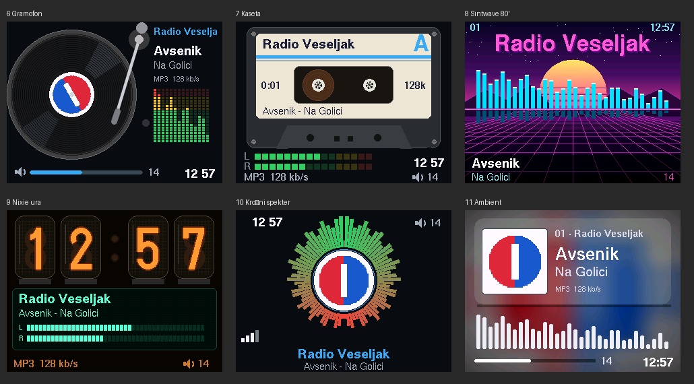

# ZRadio

> **V razvoju.** Zvočni izhod (PCM5102 + PAM8403) še ni preizkušen na napravi; zaslon, WiFi, predvajanje toka
> in spletni panel delujejo. Uporaba na lastno odgovornost.

Internetni radio na **ESP32-S3 N16R8** z barvnim zaslonom **ILI9341 2,4"**, DAC-om **PCM5102** in ojačevalnikom **PAM8403**.
Lastna programska oprema (PlatformIO, Arduino core 3), upravljanje z enkoderjema in spletni panel v slovenščini.
Pini, zaslon in vhodi se nastavljajo v panelu – brez ponovnega prevajanja.



## Funkcije

**Zvok**
- MP3, AAC/AAC+, FLAC, Opus, Vorbis; HTTP in HTTPS, M3U/PLS/HLS (ESP32-audioI2S 3.4.4 s popravki stabilnosti)
- Mehki prehodi glasnosti, izenačevalnik (prednastavitve), mono, omejitev glasnosti
- Samodejna ponovna povezava, čuvaj toka (tihi zastoj), opozorilo ob praznem medpomnilniku

**Zaslon** (TFT 320x240, slika v PSRAM, na zaslon gredo le spremenjeni pasovi)
- 12 postavitev: Klasična, Kartica, Radijska skala, Velika ura, Celozaslonski, Obroči (slog Volumio),
  Gramofon, Kaseta, Sintwave 80', Nixie ura + VFD, Krožni spekter, Ambient (barve logotipa)
- 12 barvnih tem in ločena nočna tema, nočna svetlost osvetlitve
- Prikaz zvoka: VU, spekter (FFT), zrcalni spekter, analogna merilnika z iglama, osciloskop
- Logotipi postaj (samodejno z radio-browser.info ali lastna slika)
- Meni na radiu: časovnik izklopa, izenačevalnik, prikaz zvoka, postavitev, tema, svetlost, priljubljene, pripravljenost
- Podprti tudi OLED SSD1306 / SH1106 / SSD1309 (I2C)

**Spletni panel** (`http://zradio.local`)
- Predvajalnik, urejevalnik postaj (uvoz CSV/M3U/PLS/JSON, iskanje po radio-browser.info, logotipi)
- **Videz**: izbira postavitve in teme s sličicami, živ predogled zaslona
- **Strojna oprema**: predlog pinov, preverjanje konfliktov, risba plošče, tabela vezave
- Navidezna enkoderja, IR učenje tipk, WiFi, OTA, varnostna kopija
- **Diagnostika**: zgodovina zagonov z razlogi, povzetek sesutja (coredump), pomnilnik, dnevnik, ki preživi ponovni zagon

**Zanesljivost**
- Varni način po 3 neuspelih zagonih (samo spletni panel)
- Samodejni ponovni zagon ob kritično nizkem pomnilniku ali dolgotrajni izgubi WiFi
- Brez WiFi: dostopna točka `ZRadio-xxxx` / `zradio1234`, captive portal na 192.168.4.1

## Strojna oprema in vezava

| Funkcija | GPIO |
|---|---|
| PCM5102 BCK / LCK / DIN | 21 / 15 / 47 |
| TFT ILI9341 SCK / MOSI / CS / DC / RST / LED | 12 / 11 / 10 / 9 / 14 / 2 |
| Enkoder 1 A / B / SW (glasnost) | 4 / 5 / 6 |
| Enkoder 2 A / B / SW (postaje, meni; vklopi v panelu) | 16 / 17 / 18 |
| IR (neobvezno) | npr. 7 |

- PCM5102: `SCK` → GND, mostički H1L/H2L/H4L = L, H3L (XSMT) = H; 100 nF med VIN in GND ob modulu.
- TFT na **3V3** (MISO in dotik nista potrebna), enkoderji na 3V3, PAM8403 na **5 V**.
- Napajanje: vsaj 5 V / 2 A. Načrt: 12 V adapter → stikalo → sinhroni buck 5 V (ESP32 prek USB, ostalo prek sponk).

## Upravljanje

| | Vrtenje | Klik | Dolg pritisk |
|---|---|---|---|
| Enkoder 1 | glasnost | utišaj | vklop / pripravljenost |
| Enkoder 2 | brskanje po postajah | predvajaj izbrano | meni |

## Namestitev

**Prva namestitev:** z [zadnje izdaje](../../releases/latest) prenesi `zradio-full.bin`, odpri
<https://espressif.github.io/esptool-js/> v Chrome/Edge, *Connect* → *Erase Flash* → `zradio-full.bin` na naslov **0x0** → *Program*.

**Posodobitev:** panel → Sistem → naloži `zradio-ota.bin` (nastavitve ostanejo).

**Prevajanje:**
```
pio run -t upload
pio device monitor
```
Platforma *pioarduino* (Arduino core 3.3.x, ESP-IDF 5.5). Spletni panel (`web/index.html`) se ob prevajanju stisne v firmware.

**Nova izdaja:** oznaka `v*` na GitHubu sproži gradnjo – Release z `zradio-full.bin`, `zradio-ota.bin`, `zradio.elf`.
Sklad sesutja iz Diagnostike dekodiraš z `xtensa-esp32s3-elf-addr2line -pfiaC -e zradio.elf 0x… 0x…`.

## Preizkus postavitev na računalniku

Postavitve se izrišejo z isto knjižnico kot na radiu (LovyanGFX, platforma framebuffer):
```
pio run                                  # prenese LovyanGFX in U8g2
hosttest/build.sh
cd hosttest && ./host 8 0 1 spectrum     # postavitev, tema, logotip, prikaz zvoka -> out_8_0_1.ppm
```

## Struktura

```
src/player.*       predvajalnik v lastnem opravilu, mehki prehodi, VU
src/display_tft.*  barvni zaslon: teme, postavitve, meni
src/display.*      OLED in preklop na TFT
src/spectrum.*     FFT za spekter in osciloskop (vzorci iz knjižnice prek zr_pcm_tap)
src/logo.*         prenos, pretvorba in predpomnilnik logotipov
src/app.*          logika: glasnost, postaje, meni, pripravljenost, časovnik
src/input.*        enkoderji, tipke, IR NEC
src/config.*       nastavitve (JSON v LittleFS), tabela pinov, preverjanje
src/web.*          REST API + vgrajen panel
src/diag.*, flashguard.*   diagnostika, varovala
lib/ESP32-audioI2S knjižnica za zvok s popravki (odložen stopSong, zr_pcm_tap)
hosttest/          izris postavitev na računalniku
```

## API

| | |
|---|---|
| `GET /api/status` | stanje predvajalnika |
| `POST /api/cmd?a=next\|prev\|vol_up\|vol_down\|mute\|power\|play_stop\|fav`, `?play=3`, `?vol=12` | ukazi |
| `POST /api/input?enc=1\|2&ev=l\|r\|c\|h` | navidezni enkoder |
| `GET/POST /api/stations`, `GET/POST /api/config` | postaje, nastavitve |
| `GET /api/screen` | slika zaslona (RGB332 160x120) |
| `GET /api/info`, `GET /api/diag`, `GET /api/backup` | informacije, diagnostika, varnostna kopija |
| `POST /api/ota`, `POST /api/reboot` | posodobitev, ponovni zagon |

## Načrtovano

- 3D-tiskano ohišje (OpenSCAD)
- MQTT + Home Assistant autodiscovery

Zgodovina razvoja: [CHANGELOG.md](CHANGELOG.md)
